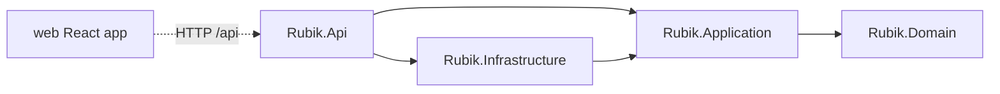
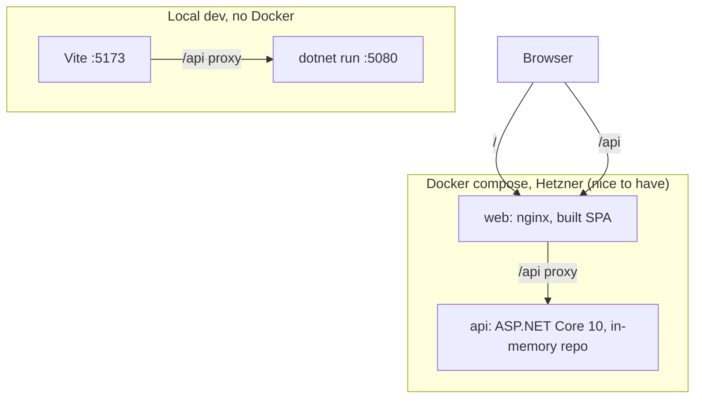

# Architecture Spine - Rubik's Cube Simulator

## Design Paradigm

Hexagonal (ports and adapters) over a pure, stateless domain. Dependencies point inward only.

| Layer | Project | Holds |
| --- | --- | --- |
| Domain | `Rubik.Domain` | `Cube`, `Move`, rotation, `ExplodedViewRenderer`. No packages, no I/O. |
| Application | `Rubik.Application` | Use cases, `ICubeRepository` (port), `Result<T>`, typed errors. |
| Infrastructure | `Rubik.Infrastructure` | `InMemoryCubeRepository` (adapter). |
| Api | `Rubik.Api` | Controllers, error mapping, DI composition root, OpenAPI. |
| Frontend | `web/` | React app; talks to the Api over HTTP only. |



## Invariants & Rules

### AD-1 - Dependency direction is compiler- and test-enforced [ADOPTED]

- **Binds:** all backend projects
- **Prevents:** engine logic leaking HTTP or storage concerns; circular references
- **Rule:** Api -> Application, Infrastructure; Infrastructure -> Application; Application -> Domain; Domain references nothing. A test in `Rubik.Api.Tests` reads assembly references by reflection and fails on any other edge. Only Api registers concrete adapters in DI.

### AD-2 - One rotation function; no permutation tables [ADOPTED]

- **Binds:** FR-1, FR-2
- **Prevents:** six hand-written face turns that disagree; orientation bugs
- **Rule:** The `Cube` is 26 cubies at (x,y,z) in {-1,0,1}, each sticker carrying a normal vector. A Move rotates the coordinates and normals of the 9 cubies in the layer by 90 degrees through one shared function parameterised by face and direction. Standard orientation: Green front, Red right, White up.

### AD-3 - Exploded view is a Domain projection, computed once, in the backend [ADOPTED]

- **Binds:** FR-3, FR-8
- **Prevents:** the frontend re-deriving layout and colours; the engine knowing about printing
- **Rule:** `ExplodedViewRenderer` (Domain) maps sticker normal to face and the other two coordinates to row and column, and produces both the `faces` grids and the `explodedView` text lines. The Cube type exposes no layout. Each `faces` grid is row-major in the exploded-view net orientation, so the tile grid and the text always agree. The frontend renders `faces` as tiles and `explodedView` as text and never recomputes either. The TTC expected output is a test fixture at Domain, API and UI levels.

### AD-4 - The Cube is derived from the Move list; only the list is stored [ADOPTED]

- **Binds:** FR-4 to FR-7, FR-11
- **Prevents:** two sources of truth (stored cube vs moves); undo that cannot be replayed
- **Rule:** A Cube Session persists `{ cubeId, moves[] }` only. Every read rebuilds the Cube by replaying `moves` on a solved Cube. `revision` is derived from `moves` alone (`CubeRevision.Of`: a hash of the notation), never from their count: undo and new moves can bring the count back to an earlier number with a different history.

### AD-5 - The repository port owns atomicity [ADOPTED]

- **Binds:** FR-4 to FR-7
- **Prevents:** service-level locks that break when storage changes; lost updates under concurrent requests
- **Rule:** `ICubeRepository` exposes `CreateAsync`, `GetAsync` and one compare-and-set `TryUpdateAsync(cubeId, expectedRevision, newMoves)` returning `Updated | RevisionConflict | NotFound`. Apply, undo and reset all compute the new list in Application and go through `TryUpdateAsync`. The in-memory adapter makes the check-and-write atomic per cube. `expectedRevision` is the caller's value and is passed to the compare-and-set unchanged; Application never substitutes the revision it just read. `cubeId` is a `Guid` generated in Application. The repository is registered as a singleton, because a scoped or transient lifetime would lose all sessions.

### AD-6 - Failures are values; one mapping to HTTP [ADOPTED]

- **Binds:** FR-4 to FR-7
- **Prevents:** exceptions for expected failures; scattered status-code decisions
- **Rule:** Domain reports an invalid token with `Move.TryParse(token, out Move)`. Application returns `Result<T>` with typed errors `InvalidMove(token)`, `CubeNotFound`, `RevisionConflict`. One mapper in Api turns a Result into 200 / 400 / 404 / 409 with an `ErrorDetails` body (`type`, `title`, `status`, `detail`, `traceId`). A global handler turns unexpected exceptions into 500 `ErrorDetails` without stack traces. Undo or reset on an empty session is a successful no-op (revision unchanged); an apply request with an empty `moves` list is `400`. Controllers stay thin: parse request, call one use case, map the Result.

### AD-7 - The wire contract is plain, and OpenAPI is its source of truth [ADOPTED]

- **Binds:** FR-4 to FR-11
- **Prevents:** contract drift between backend and frontend; envelope-versus-HTTP ambiguity
- **Rule:** Success returns the data directly with 200, except `POST /api/cubes`, which returns 201 Created with a `Location` header (`/api/cubes/<cubeId>`) and the same body: `{ cubeId, revision, moves, faces, explodedView }`; apply requests carry `{ expectedRevision, moves }`; undo and reset carry `{ expectedRevision }`. Errors use the real HTTP status. Backend publishes `swagger.json`; `openapi-typescript` generates the frontend types into `web/src/api/generated/`, committed to the repo and regenerated by one npm script. `ApiResult<T> = { ok: true; data: T } | { ok: false; status: number; error: ErrorDetails }` and the fetch wrapper are hand-written.

### AD-8 - Same-origin topology; the frontend uses only relative `/api` paths [ADOPTED]

- **Binds:** FR-8 to FR-11, deployment
- **Prevents:** base-URL configuration, CORS drift, environment-specific frontend builds
- **Rule:** The frontend calls `/api/...` only. Dev: Vite proxies `/api` to the API on port 5080. Docker: nginx serves the built SPA and proxies `/api` to the `api` container. The backend registers no CORS. Non-`/api` paths such as `/cubes/<cubeId>` fall back to `index.html` in both Vite and nginx, so a shared link opens the app.

### AD-9 - Server is the source of truth for the UI [ADOPTED]

- **Binds:** FR-8 to FR-11
- **Prevents:** client-side cube logic; a second engine in TypeScript; stale state after conflicts
- **Rule:** The UI keeps the `cubeId` (in the URL) and the last API response in one `useCubeSession` hook (`useReducer` plus the fetch wrapper). Every mutation sends the last seen `revision`. On 409 the hook reloads the session and surfaces the conflict message. Keyboard keys `F R U B L D` send `F R U B L D`; `f r u b l d` send `F' R' U' B' L' D'`. The API accepts only the standard tokens.

### AD-10 - SOLID, DRY, KISS and a test for every behaviour [ADOPTED]

- **Binds:** all projects and files
- **Prevents:** speculative abstraction, copy-paste divergence, untested behaviour
- **Rule:** Code follows SOLID, DRY and KISS. A justified exception carries a one-line comment naming the principle and the reason. Each `src` project has a `*.Tests` project; every class or module with behaviour has tests in the same change; DTOs, records, DI registration and `Program.cs` are covered by integration tests. The frontend keeps tests beside the file. The same rule lives in the root `CLAUDE.md` so it loads in every session.

### AD-11 - Reproducible build and run [ADOPTED]

- **Binds:** NFR Platform, Delivery, Documentation
- **Prevents:** "works on my machine"; a reviewer who cannot start the app
- **Rule:** `global.json` pins .NET SDK 10.0.x (the dev machine also has SDK 2.1, 3.0, 8 and 9). `Directory.Build.props` sets Nullable and TreatWarningsAsErrors; `Directory.Packages.props` holds all package versions. The README lists prerequisites and the two-terminal run (`dotnet run`, `npm run dev`), plus the expected output, and is verified in a fresh clone.

### AD-12 - API errors are logged in one place, with a trace id [ADOPTED]

- **Binds:** FR-4 to FR-7, NFR Observability
- **Prevents:** silent failures; duplicate or inconsistent logging; secrets or stack traces leaking to clients
- **Rule:** Only the Api layer logs errors, in the Result-to-HTTP mapper and the global exception handler (Application and Domain do not log). Expected failures (400, 404, 409) log at Warning without an exception; unexpected exceptions (500) log at Error with the exception. Every entry carries `operation`, `cubeId` when known, `status` and the request `traceId`; the same `traceId` is returned in `ErrorDetails` so a client report can be matched to a log line. Logging uses `ILogger` to the console (Docker collects stdout); no logging framework. Tests assert the level and properties with `FakeLogger`.

## Consistency Conventions

| Concern | Convention |
| --- | --- |
| Naming | Namespaces mirror projects (`Rubik.Domain.Cubes`); interfaces `I*`; async methods `*Async`; one public type per file; tests `{Class}Tests`, methods `Method_Condition_Result`; frontend components PascalCase, tests `Foo.test.tsx` beside the file |
| Data and formats | `cubeId` Guid; browser route `/cubes/<cubeId>`; JSON camelCase; colours as strings (`"White"`); face keys `up left front right back down`; exploded-view letters `W Y G B R O`; move tokens `F R U B L D` with optional `'`, case-sensitive |
| Errors | `ErrorDetails` (with `traceId`) for every non-2xx; 400 invalid move, 404 unknown cube, 409 revision conflict, 500 unexpected |
| State and cross-cutting | Mutation only through `TryUpdateAsync`; `ILogger` only (AD-12), errors logged in Api only; config via `appsettings.json` and env vars, no secrets; `GET /health`; frontend TypeScript strict, ESLint plus Prettier, no `any` |
| Ports | API 5080, web dev 5173, Docker 8080 |

## Stack

| Name | Version |
| --- | --- |
| .NET SDK / ASP.NET Core | 10.0.302 (LTS) |
| xunit.v3 | 4.0.2 |
| Microsoft.AspNetCore.Mvc.Testing | 10.0.13 |
| Microsoft.Extensions.Diagnostics.Testing | 10.11.0 |
| Swashbuckle.AspNetCore | 10.3.0 |
| Node.js | 24 (Vite needs 20.19+ or 22.12+) |
| React | 19.3.1 |
| Vite | 8.3.4 |
| TypeScript | 6.0.3 (typescript-eslint requires below 6.1; do not use 7.x yet) |
| typescript-eslint | 8.71.2 |
| @vitejs/plugin-react | 6.1.2 (React Compiler is optional, see Deferred) |
| Vitest | 5.0.5 |
| @testing-library/react | 16.3.3 |
| @testing-library/user-event | 14.6.8 |
| jsdom | 30.1.3 |
| @playwright/test | 1.64.1 |
| ESLint | 10.12.0 |
| Prettier | 3.9.10 |
| openapi-typescript | 7.13.0 |

## Structural Seed



```text
rubik-cube/
  global.json  Directory.Build.props  Directory.Packages.props  docker-compose.yml
  src/
    Rubik.Domain/  Rubik.Application/  Rubik.Infrastructure/  Rubik.Api/
  tests/
    Rubik.Domain.Tests/  Rubik.Application.Tests/  Rubik.Infrastructure.Tests/  Rubik.Api.Tests/
  web/
    src/api/ (generated/, apiResult.ts, client.ts)  src/features/cube/  src/app/
    e2e/ (one Playwright flow)  vite.config.ts  nginx.conf  Dockerfile
  README.md  CLAUDE.md
```

## Capability -> Architecture Map

| Capability | Lives in | Governed by |
| --- | --- | --- |
| FR-1, FR-2 Solved state, rotate | Rubik.Domain | AD-2, AD-10 |
| FR-3 Exploded view | Rubik.Domain (renderer) | AD-3 |
| FR-4 to FR-7 Session API | Application use cases, Infrastructure repo, Api controllers | AD-4, AD-5, AD-6, AD-7 |
| FR-8 to FR-11 UI | web/src/features/cube | AD-3, AD-7, AD-8, AD-9 |
| FR-12 Orbit (Could) | web/src/features/cube | AD-9 |
| Platform, Delivery, Documentation NFRs | repo root, README | AD-1, AD-10, AD-11 |

## Deferred

- **React Compiler:** optional. With Vite 8 and plugin-react 6 it needs `@rolldown/plugin-babel` 0.2.4 plus `babel-plugin-react-compiler` 1.0.0 (or the experimental Rust compiler). Enable only if setup stays trivial (KISS); no code may rely on it.
- **Request limits:** no cap on moves per request or on session count in v1; revisit with persistence.
- **3D orbit library and approach (FR-12):** Could; decided only if the layer is reached. It consumes `faces` and must not hold cube logic (AD-9).
- **Docker details (images, nginx config, Hetzner host, TLS):** nice to have; AD-8 already fixes the topology.
- **CI (GitHub Actions):** optional; build plus tests on both sides if time allows.
- **Persistent storage:** none in v1; the port in AD-5 is the seam. Session expiry and memory growth of the in-memory store are not handled in v1.
- **Auth, rate limiting, centralised log storage, metrics and tracing beyond the console logs of AD-12:** out of scope for v1.
