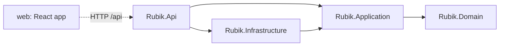

# Architecture

A Rubik's cube simulator: a .NET 10 backend owns the cube logic, a React frontend displays it. The two talk only over HTTP.

## Overview

Dependencies point inward. `Rubik.Domain` references nothing; a test fails the build if any project references another in the wrong direction.

| Project | Responsibility |
| --- | --- |
| `Rubik.Domain` | The cube engine and the exploded-view projection. Pure code, no I/O. |
| `Rubik.Application` | Use cases (create, read, apply moves, undo, reset), the repository port, `Result<T>`. |
| `Rubik.Infrastructure` | In-memory repository, the only place that stores sessions. |
| `Rubik.Api` | Controllers, error mapping to HTTP, OpenAPI. |
| `web/` | React UI: coloured tiles, text exploded view, move buttons, history. |

## Key decisions and why

- **The cube is derived, never stored.** A session stores only its ordered move list; the cube is rebuilt by replaying it. Undo, reset and history are list operations, and there is no second state to keep in sync.
- **One rotation function for all six faces.** The cube is 26 cubies with coordinates and sticker normals; a face turn rotates the coordinates and normals of one layer by 90 degrees. There are no hand-written permutation tables to get wrong.
- **The exploded view is a separate projection.** The engine knows nothing about printing. The backend produces both the face grids and the text lines once; the frontend only displays them.
- **The repository owns atomicity.** One compare-and-set method takes an expected version. Two people sharing a link cannot silently overwrite each other: the second request gets `409 Conflict`. A database can replace the in-memory repository without touching the use cases.
- **Failures are values.** Invalid moves, unknown cubes and version conflicts are `Result` errors mapped to 400, 404 and 409 in one place, with a plain `ErrorDetails` body.
- **OpenAPI is the contract.** Frontend types are generated from the backend's OpenAPI document, so the two sides cannot drift unnoticed.
- **Same-origin.** The frontend calls relative `/api` paths; Vite (dev) or nginx (Docker) proxies them. No CORS, no base URL to configure.

## Testing

Every project has a test project. The engine, renderer, use cases, repository and error mapping have unit tests; the API has integration tests that run the full pipeline, including the required `F R' U B' L D'` sequence against the expected exploded view, and concurrent requests. The UI has component tests and one end-to-end flow.
